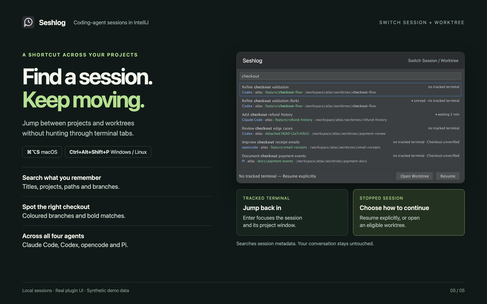

# Seshlog

Find, search and resume your **Claude Code, Codex, opencode and Pi** sessions in IntelliJ.
Pick up an old conversation, jump to a running terminal, or continue the work in another Git worktree.

## Get started

1. Install [Seshlog from the JetBrains Marketplace](https://plugins.jetbrains.com/plugin/33850-seshlog--coding-agent-session-manager),
   or search for **Seshlog** in **Settings → Plugins → Marketplace**.
2. Open **View → Tool Windows → Seshlog**. Your saved sessions appear, grouped by project.
3. Double-click a session to resume it or jump to its running terminal. Single-click to preview
   its messages; right-click for more actions.

Requires **IntelliJ IDEA 2026.2 or newer** with the bundled Terminal plugin enabled.
Install the agent's CLI to start or resume sessions; Pi needs **0.84.2 or newer**.
If you use custom data folders or executables, set them under **Settings → Tools → Seshlog**.

### Codex terminal tracking

To let Seshlog follow thread switches inside a running Codex terminal, add this to
`~/.codex/config.toml`. If you already have a `[tui]` section, add the setting there:

```toml
[tui]
terminal_title = ["project", "thread-id"]
```

Restart any running Codex terminals after saving. Keep `thread-id` enabled so Seshlog can identify
the current conversation after `/new`, `/clear`, `/resume` or a switch through the resume picker.

## Find your way back

- **Search your history.** Search messages, titles and paths. Use `"quoted phrases"` for exact text,
  and **Search in** to choose your messages, assistant replies or tool activity.
- **Follow your running agents.** Working, waiting and unread badges show which sessions need a look.
  Use **Next Session Needing Attention** to jump to the next unread reply.
- **Keep the list useful.** Filter by agent, project or date. Pin sessions, give them local names,
  or hide ones you're finished with.
- **Read before resuming.** Preview messages or open the full conversation. Right-click to inspect
  recorded file changes or copy the latest assistant reply.

### Switch with the keyboard

Press **⌘⌥S** on macOS or **Ctrl+Alt+Shift+P** on Windows/Linux to find a session by its title,
project, path or branch. Like the tool window, it shows only this project unless **All Projects** is
on. Use **Up/Down** to select it.

**Enter** jumps to a tracked terminal and its project window. For a stopped session, it focuses
**Resume** so you can choose when to launch. Use **Left/Right** to move between **Open Worktree**
and **Resume**. Change the shortcut in **Settings → Keymap**.

### Continue in a worktree

For Claude Code and Codex sessions, right-click and choose **Open Worktree in IntelliJ** to open
that checkout, or focus its existing window.

Choose **Open Worktree and Fork Session** to start a separate conversation there with the original
history. Your original session stays available. Both conversations use the same worktree files.

When you're done with a worktree, right-click its folder and choose **Delete Worktree…**. Git removes
it only if it has no uncommitted or untracked changes. The conversations are kept, and you can hide
their sessions in the same step.

## Screenshots

<table>
  <tr>
    <td><a href="docs/marketplace/01-hero.png"></a></td>
    <td><a href="docs/marketplace/02-worktrees.png"></a></td>
  </tr>
  <tr>
    <td><a href="docs/marketplace/03-sessions.png"></a></td>
    <td><a href="docs/marketplace/04-search.png"></a></td>
  </tr>
  <tr>
    <td colspan="2" align="center"><a href="docs/marketplace/05-switcher.png"></a></td>
  </tr>
</table>

Click any screenshot to view it full size.

## Your data stays local

Seshlog makes no network requests and has no telemetry. It reads your agent history without
rewriting the saved conversations.

Search keeps an unencrypted local index of words and positions from your sessions, including tool
activity. It can reveal conversation content, so treat it as private. Raw conversation copies and
query history are not saved. You can clear or rebuild the index in **Settings → Tools → Seshlog → Search**.

Local diagnostic logs are enabled by default. Turn off **Record session diagnostics** in settings
if you don't want them. See the [usage guide](docs/usage.md#local-data-and-privacy) for storage details.

## Help and development

The [usage guide](docs/usage.md) covers search options, copying, activity badges, limitations and
troubleshooting. [Report a problem or suggest a feature](https://github.com/Bigsy/seshlog/issues).

To work on Seshlog, use **JDK 25**:

```sh
make run      # Open a sandbox IDE
make check    # Run tests
make release  # Build and check the plugin ZIP
```

To install your build, choose **Settings → Plugins → ⚙ → Install Plugin from Disk…** and select
`build/distributions/seshlog-<version>.zip`.
See [PLAN.md](PLAN.md) for current work.

[MIT license](LICENSE)
