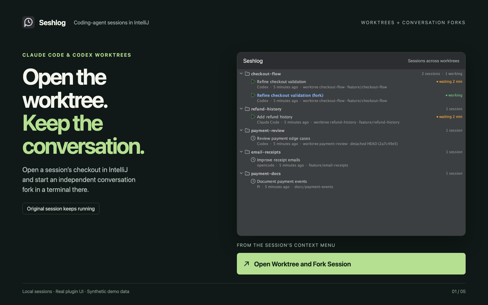
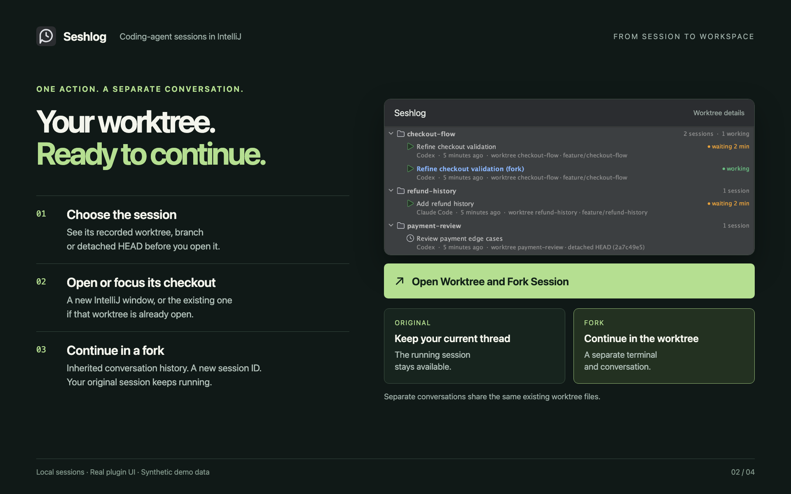
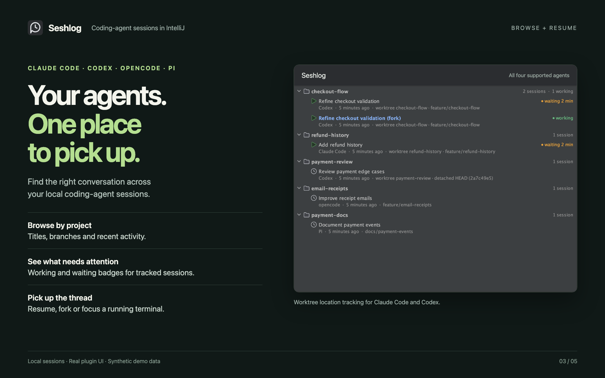
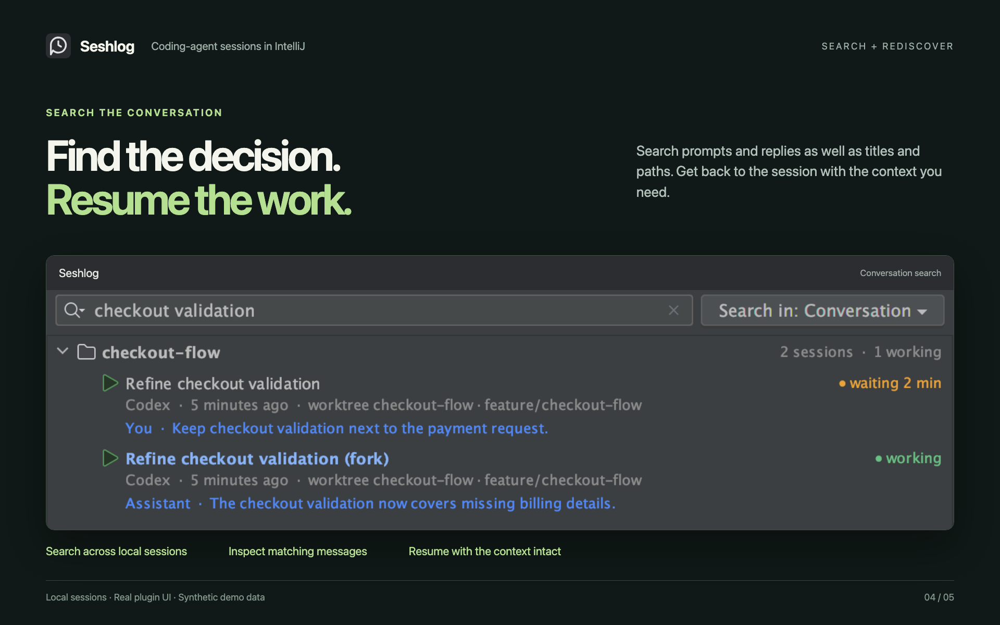

# Seshlog

Open a **Claude Code or Codex worktree** in IntelliJ and continue the conversation in an independent
fork. Browse, search and resume your local **Claude Code, Codex, opencode and Pi** sessions from one
tool window.

[JetBrains Marketplace](https://plugins.jetbrains.com/plugin/33850-seshlog--coding-agent-session-manager)

<table>
  <tr>
    <td><a href="docs/marketplace/01-hero.png"></a></td>
    <td><a href="docs/marketplace/02-worktrees.png"></a></td>
  </tr>
  <tr>
    <td><a href="docs/marketplace/03-sessions.png"></a></td>
    <td><a href="docs/marketplace/04-search.png"></a></td>
  </tr>
</table>

Click a screenshot to view it full size.

## What it does

- Shows recorded Claude Code and Codex worktrees and opens eligible checkouts in a new IDE window,
  or focuses the window already using that checkout.
- **Open Worktree and Fork Session** starts an independent conversation fork in that window's
  terminal while the original session keeps running.
- Groups sessions by project, with titles, branches and recent activity.
- **Seshlog: Switch Session / Worktree** searches session metadata across projects in a compact
  keyboard popup, focuses an associated terminal, or offers explicit Resume for a stopped session.
- Starts, resumes or forks a session in an IDE terminal; focuses its tab if it is already running.
- Searches titles, project paths and conversations, with highlighted matches and a message preview.
- Filters by agent, project and date. Pin, rename or hide sessions to keep the list manageable.
- Shows activity for tracked sessions, notifies you when they need input, and offers to restore
  eligible sessions after an IDE restart.
- Marks newly finished turns as unread, shows working/unread counts on project rows, and jumps
  to the next unread session from the toolbar or a configurable shortcut.
- Opens conversations in read-only editor tabs and renders Markdown in the recent-message preview.
- Includes Claude subagent activity when **Tool activity** is selected. Linked continuations share one current session row;
  **Earlier Sessions** opens the preceding transcripts without changing them.
- Lists recognized file changes with Open and Compare with Current actions.
- Copies the latest assistant reply, or the latest explicit Claude Code or Codex plan, without
  selecting terminal output.

Works with both Classic and Reworked terminals.

## Get started

You need IntelliJ IDEA **2026.2 or newer** with the bundled Terminal plugin, plus at least
one supported agent installed and available on your terminal shell's `PATH`. Pi requires **0.84.2 or newer**.

Open **View → Tool Windows → Seshlog** to browse your sessions.
Use **Settings → Tools → Seshlog** to change data directories, executable paths, per-agent command
arguments, notifications and restart behaviour.

To build and install from source, use JDK 25 and run:

```sh
./gradlew buildPlugin
```

Then choose **Settings → Plugins → ⚙ → Install Plugin from Disk…** and select
`build/distributions/seshlog-<version>.zip`.

## Using Seshlog

The **Filters** menu contains agent, date, hidden-session and sibling-worktree controls.
Project and date filters apply to both browsing and search; you can include sibling worktrees or show sessions from all projects.

**Search in** beside the search field chooses **Your messages**, **Assistant replies** and
**Tool activity**. The default **Conversation** includes your messages and assistant replies,
with tools off. Titles (including local overrides) and project paths are always included.
You can turn off all three sources for **Titles & paths**. The preference is shared across
project windows and remembered across restarts; clearing the query preserves it.

Search ranks by relevance; ordinary words are optional signals. Use `"quoted phrases"` to require
exact text within an included title, path or single eligible conversation entry. Multiple phrases
may match different eligible entries. Exact technical identifiers receive priority. Rows label
their displayed evidence as **Title**, **Project path**, **You**, **Assistant**, **Tool call** or
**Tool result**. A matching provider title remains visible in the excerpt even if you renamed the row.

Select a result and choose **Open Conversation** to read it in a read-only editor tab.
The preview and **F3 / Shift+F3** navigation use the selected sources; excluded activity remains
visible as context. Title/path results initially explain the metadata match. An opened editor tab
keeps the query and sources it was opened with, shown above the conversation. Normal IDE Find
searches the whole document. Markdown rendering is available when its IDE plugin is enabled.
Clear the search to return to the recent-message preview.
Click the preview header to collapse it to a single row under the list, and again to expand it;
the choice is remembered across restarts.

Use **New Session** in the toolbar or a project row to start an agent with its configured executable
and arguments. Right-click a session to resume, fork, pin, rename, hide or copy from it. **Kill Session** stops its
processes and closes its terminal tab in the current project; the saved conversation remains available.

For keyboard copying, assign **Seshlog: Copy Last Assistant Message** and **Seshlog: Copy Latest Plan**
under **Settings → Keymap**. They work from the session list, conversation viewer or a terminal
associated with a known session. Shortcuts are unassigned by default. Terminal shortcuts recheck
the running agent in the background, so switching from Claude Code to Codex in the same tab does
not copy the previous session's reply. When an agent exits, its tab is detached from the session; copying from
that tab still uses the last session until another agent is identified.

An **unread** badge means a tracked agent finished a turn you have not viewed yet. It survives
IDE restarts and clears when you view the associated terminal in the active IDE window, or view
the latest reply in the preview or conversation viewer. Selecting a row with the preview hidden
does not clear it. Starting another turn also clears the previous completion. A finished turn
can include an error; the badge does not imply success. Interrupted turns are not marked unread.

Project rows show counts such as **2 working · 1 unread**, including when collapsed. Counts follow
the current filters. Use the toolbar's **Next Session Needing Attention** action, or assign
**Seshlog: Next Session Needing Attention** under **Settings → Keymap**, to cycle through unread
sessions in tree order. It expands the target project and opens the associated terminal or latest
reply. The shortcut is unassigned by default and does not change your filters. The tool-window icon also
shows unread attention, and the optional **Seshlog attention** status bar widget shows counts and
opens the next session needing attention.

### Quick session / worktree switcher

Use **⌘⌥S** on macOS, **Ctrl+Alt+Shift+P** on Windows/Linux, or **Find Action → Seshlog: Switch Session / Worktree**.
The shortcut can be changed in **Settings → Keymap**. An open project is required. Empty search shows
recently active sessions; type words from a local or agent title, project name/path, or recorded or
observed branch. All words must match somewhere in that metadata, case-insensitively. Conversation
text is not searched. Title matches are favoured over project, branch and path matches, with recency
breaking ties. Up/Down selects a row; Enter focuses its verified associated terminal and
project window. Activity and unread badges use the existing session state; selecting a row alone
does not mark it read.
Agents are blue, branches green, and paths and status muted; matching words are bold. Selected rows
use the IDE's selection colours while retaining bold matches.

For stopped sessions, Enter moves focus to the explicit **Resume** button; activate it to launch.
Use Left/Right or Shift+Tab/Tab to move between **Resume** and **Open Worktree** when both are enabled.
**Resume** opens or focuses a verified linked worktree before launching there. Other directories
resume in the most specific containing open project within the same observed checkout, or in the
invoking project's terminal using the recorded cwd. A failed or incomplete rescan blocks Resume.
If another operation is using the worktree, the popup stays open with a retry message.
**Open Worktree** opens/focuses an eligible linked checkout without starting an agent. Missing or
uncertain locations block launches; unverified locations are checked before Resume. Running sessions
without an associated IDE terminal are labelled and never silently resumed.

The popup searches across indexed projects and agents, respects locally hidden sessions, and leaves
tool-window filters unchanged. It shows up to 200 matches; narrow the query to find older sessions.
Existing rows retain their order during updates, and selection follows the session identity.
Recent arrivals can replace lower-priority unselected rows when the list is full. Claude continuation
chains show their current part, while independently running earlier parts remain accessible.
Reopening the popup sorts by recent activity again. Changed or unverifiable targets require a fresh
selection instead of navigating to a different session. No query history is saved.

### Agent worktrees

Claude Code and Codex session rows show a **worktree** label when local Git metadata verifies a
linked checkout. The label uses the branch currently observed in that checkout, or **detached
HEAD** with a short commit. Hover for the full checkout path, the session's reported subdirectory,
and the location evidence. Historical session branch names are kept separate from observed Git state.

Right-click and choose **Open Worktree in IntelliJ** to open the checkout root in a new window.
Your source project and its terminals stay open. If the checkout is already open in this IDE
instance, the action becomes **Focus Worktree Window**, including for symlink aliases or the
invoking project itself. IntelliJ's usual trust/import flow applies. Seshlog does not create
worktrees, switch branches, move changes, or transfer the running agent or its terminal.

Choose **Open Worktree and Fork Session** to also start an independent conversation in a new
terminal in that window. The fork inherits the selected session's history and gets its own session
ID; the original can keep running. The IDE opens at the checkout root, while the new terminal uses
the session's recorded subdirectory. If that directory has disappeared or the session's location
changes while opening, Seshlog stops the launch and reports the problem. Both conversations use
the same worktree files; this action does not create another Git worktree. A deliberate later
invocation creates another fork, while repeated clicks during opening are coalesced.

**Sibling worktrees** includes sessions in related checkouts, both external siblings and nested
checkouts such as a project's `.claude/worktrees/...`. Turning it off keeps sessions in the
project's own checkouts and ordinary subdirectories. This applies to browsing and search.

Location means **latest recorded**, including for stopped sessions. Claude tracking uses transcript
cwd envelopes and explicit worktree-state records; tool-result envelopes can reveal a move without
another prompt. Codex uses turn context ahead of its initial launch header. Database-only locations
are considered, but a disagreement that cannot be ordered against later context is marked uncertain.
Tool commands, tool-specific working directories, child agents, and prose are not evidence of a
parent-session move. A handoff with no supported location record cannot be confirmed. A cleared
Claude worktree state alone does not identify the restored directory.

Unavailable or uncertain worktrees have disabled opening actions. Previously verified associations
are retained in memory when a checkout disappears; no parent checkout is opened as a fallback.
A checkout deleted before IDE startup may have only a recorded path, with no verifiable worktree
association. Git metadata and availability refresh on scans, explicit **Refresh**, and every
30 seconds plus scan time, even when transcripts are idle.

**Opening a new project inside an agent data root is disabled**, including default or configured
Codex/Claude storage. IntelliJ would write project/import files there, which conflicts with
Seshlog's read-only-agent-storage rule. Tracking and focusing a project already open there remain
available. A repository's nested `.claude/worktrees` directory is eligible when it is outside the
configured agent data root. These limits apply to both supported agents; opencode and Pi retain
their existing session behaviour.

### Limitations

- Activity detection depends on the agent and whether Seshlog can identify its running process.
  Fresh Codex sessions are identified through their writable CLI transcript on macOS (`lsof`)
  and Linux (readable `/proc` descriptors). Subagent and approval transcripts are excluded;
  unavailable or ambiguous process evidence prevents association.
- Unread completion tracking starts while Seshlog is running; old history is not marked unread
  on first discovery. Completions without usable activity/process evidence may be missed.
  Partial conversation views do not clear unread badges when the latest reply cannot be verified.
- Large conversations have search and viewer limits; partial coverage is shown in the UI.
  Images and thinking are excluded. **Tool activity** enables tool text for Claude Code, Codex
  and opencode, including Claude subagent results. Pi currently provides dialogue only.
  Shared retention limits can omit later dialogue even when tools are excluded from matching.
- **Files Changed** lists recognized operations in the retained transcript text, so it can be partial.
  Complete Write calls can be compared with the current file; edits and patches show their recorded
  operation rather than reconstructing a historical file.
- A fresh tab is reserved immediately, but association needs exact identity evidence. Fresh Pi or
  opencode sessions may remain unassociated when their process does not identify the session.
- Pi uses its saved active branch and includes user/assistant text only. Custom session directories
  must be configured in Settings. Pi sessions are not restored after a restart.
- Plan copying supports explicit Claude Code and Codex plans only. A Claude plan stored solely as
  a file reference copies that file's current contents. See the [format notes](docs/clipboard-format-evidence.md)
  for details.

## Troubleshooting session tracking

If a terminal loses its session association, run **Seshlog: Open Session Diagnostics** from
**Find Action**, or use **Settings → Tools → Seshlog → Session Diagnostics**. The session context
menu also offers it. When recording is enabled, this marks the incident and reveals the log file; when invoked from a session
or its terminal, the marker includes its reference when available.

Diagnostics are enabled by default and stay **only on this computer**, in the running IDE's log
folder under `seshlog/`. They are never uploaded or sent anywhere. Uncheck **Record session
diagnostics** in Settings → Tools → Seshlog and Apply to stop new recording. Existing files remain
available through Open Session Diagnostics, which does not re-enable logging. Queued writes that
have not started are skipped; a write already in progress may finish.
`sessions.jsonl` and three rotated backups retain **at most 20 MiB** in total. Copy all four after
the problem occurs and note the time and agent version. Sandbox `make run` IDEs and normal installed
IDEs have separate logs; the action finds the correct directory in either one.

Records cover process inspection, Codex daemon matching and uncertainty, index health, terminal
ownership, launches, exits, copy resolution and restore decisions. Paths and session IDs are hashed;
conversation text, titles, raw commands, environment variables and exception messages are excluded.
Writes run in the background; disk failure or a full queue cannot block terminal tracking. Lost
records are reported when writing recovers. See [AGENTS.md](AGENTS.md#reading-session-management-diagnostics)
for locations and instructions for reading both sandbox and daily-IDE logs.

## Privacy

Seshlog runs locally and makes **no network requests**. There is no telemetry or analytics.

Agent transcripts are read-only. Seshlog keeps settings and metadata caches in IDE storage;
raw conversation content and snippets stay in memory. Search terms, positions, source references and index versions persist in a contentless SQLite index under the IDE config directory, `seshlog/search/lexical.sqlite`. These derived words and positions can reveal conversation content; the file is not encrypted. No raw transcript copies or query history are saved. The index survives restart and Invalidate Caches, and is excluded from automatic Settings Sync and settings export.

All supported sources, including tools, are indexed within the shared limits. **Search in**
restricts query evidence, ranking and navigation; it does not change collection or retention.
Switching sources reuses compatible postings. Source preferences are IDE settings.

Settings → Tools → Seshlog → Search shows index usage and a **Refresh** action. **Manage index…**
contains Retry, Rebuild and Clear. **Storage and privacy** explains what is saved and lets you copy
the index path or open its folder. Refresh checks and reuses saved data; Rebuild and Clear cause
local reindexing on the next search. Import and Export are no longer offered: rebuilding from local
sources is inexpensive. Unavailable storage falls back to a temporary local index with a coverage
message. A second IDE using the same profile must close its saved index before maintenance can proceed.

Source filtering uses index format 3. Older format-2 indexes are preserved and use correctly
filtered temporary search until you explicitly choose **Rebuild**. Rebuild retains a recovery
copy and re-extracts local sources once.

Agent SQLite metadata reads use read-only
connections; SQLite can update an existing shared-memory index while leaving stored sessions unchanged.

## Development

```sh
make run      # Launch a sandbox IDE with the plugin loaded
make check    # Run tests
make release  # Test, build and check the plugin zip
./gradlew verifyPlugin  # Check IDE compatibility
make lexical-bench     # Opt-in synthetic BM25 quality/durability benchmark
```

Issues and pull requests are welcome. New parsing behaviour needs a synthetic fixture in
`src/test/resources/fixtures/`; never commit real transcripts.
See [AGENTS.md](AGENTS.md) for development conventions and [PLAN.md](PLAN.md) for current work.
The agreed, unimplemented embedding-server requirements are in the
[semantic search design](docs/semantic-search-design.md).
The [production BM25 report](docs/production-bm25.md) records relevance, durability and resource evidence and its remaining acceptance limits.
The [source-filter report](docs/search-source-filters.md) records the new schema, selected-source
evaluation, synthetic performance and remaining manual checks.

Keep the five most recent release entries in `src/main/resources/META-INF/plugin.xml`; when adding
another, move the oldest entry to the top of [the changelog archive](docs/changelog-archive.md).

## License

[MIT](LICENSE)
